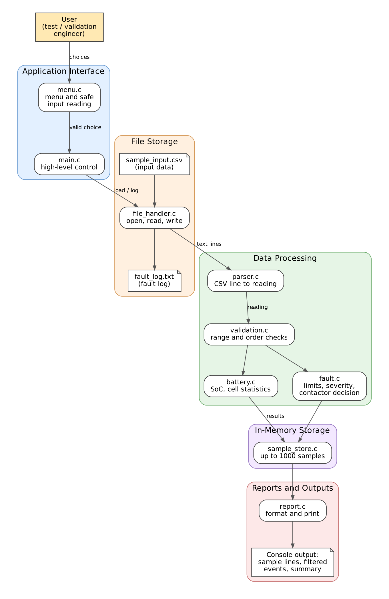

# Project Proposal

## 1. Project Information

### 1.1 Project Title

**EV Battery Management System (BMS) Simulator in C**

### 1.2 Engineering Domain

Automotive (Electric Vehicle Battery Management)

### 1.3 Student Details

| Field | Details |
|---|---|
| Student name | Nikhil Shripad Patankar |
| Roll number | 612509029 |
| Division / batch | Instrumentation and Control Engineering |
| Repository name | BMS_simulator |
| GitHub repository link | https://github.com/patankarnikhil783-svg/BMS_simulator |

### 1.4 Individual Project Declaration

I confirm that this project is my individual work. I understand the design,
source code, unit tests, Makefile and documentation included in this
repository, and I am prepared to explain or modify any part during evaluation.

Student acknowledgement: Nikhil Shripad Patankar, 07/07/2026

## 2. Engineering Scenario and Problem Definition

### 2.1 Scenario Description

**Where it occurs.** The scenario takes place in an electric vehicle (EV)
battery development and test laboratory. A battery pack is charged and
discharged on a test bench while a data logger records its measurements.

**Who is involved.** BMS software engineers, who write the battery protection
logic, and test and validation engineers, who review the recorded data to check
that the pack stayed within safe limits.

**Current working method.** The logged data is exported as a CSV file and
reviewed manually in a spreadsheet. Engineers scan the values and compare them
with the battery limits by eye.

**Information that must be managed.** For each time stamp: the voltage of every
cell in the pack, the pack current and the pack temperature. From these the
following are derived: State of Charge (SoC), cell imbalance, fault severity
and the contactor (pack disconnect) state.

**Problems with the current method.**
- Limits are applied by eye, so a borderline reading can be missed.
- Bad data such as blank cells, text or impossible values can pass unnoticed.
- Different people may apply different limits to the same data.
- There is no repeatable record of which faults were found and when.

### 2.2 Problem Statement

In an EV battery test laboratory, BMS and validation engineers need to check
recorded battery data against safety limits. They currently review the data
manually in spreadsheets, which results in missed faults, undetected invalid
readings, inconsistent limits and no repeatable fault record. The proposed
software will validate every recorded sample, check it against defined limits,
estimate the State of Charge, record faults and report the final pack status,
so that engineers can verify protection behaviour quickly and consistently.

### 2.3 Proposed Solution

The BMS Simulator is a console application written in C. It replays recorded
battery measurements through the same decision logic a Battery Management
System would use.

The application will:
- load a CSV file of battery measurements, for a pack of 4 series cells;
- validate each sample and reject malformed or implausible data with a reason;
- check cell voltage, temperature and current against warning and critical limits;
- calculate cell imbalance and estimate SoC by coulomb counting;
- decide the contactor state, which opens on a critical fault;
- keep up to 1000 processed samples in memory;
- provide a menu so the user can load a file, run the simulation, view the
  summary, filter events by severity and check a single reading entered by hand;
- write a fault log file and show a summary report.

The project is a software simulation only. It does not interface with any
hardware.

### 2.4 Target Users

| User | Responsibility | How they use the application |
|---|---|---|
| BMS software engineer | Develops battery protection logic | Replays recorded data to check that limits and decisions behave as intended |
| Test and validation engineer | Reviews battery test results | Loads logged data, reviews faults and the summary, and keeps the fault log |
| Student or evaluator (secondary) | Learns from or assesses the project | Builds, runs and tests the application to see the design in action |

## 3. Project Scope

### 3.1 In-Scope Features

1. Load battery measurements from a CSV file for a pack of 4 series cells.
2. Parse and validate every sample, rejecting malformed or implausible data
   with the line number and the reason.
3. Check each cell voltage, the pack temperature and the pack current against
   warning and critical limits.
4. Calculate cell imbalance (highest minus lowest cell voltage).
5. Estimate State of Charge (SoC) by coulomb counting.
6. Decide the contactor state, which opens on a critical fault and stays open.
7. Store up to 1000 processed samples in memory.
8. Provide a console menu to load a file, run the simulation, show the summary,
   filter events by severity and check a single reading entered by the user.
9. Validate all user input, including menu choices and file names.
10. Write a fault log file and display a summary report.

### 3.2 Out-of-Scope Features

1. Any hardware interface, such as sensors, a microcontroller or CAN communication.
2. Live (real-time) data acquisition.
3. State of Health (SoH) estimation, Kalman filtering and thermal modelling.
4. Active cell balancing.
5. A graphical user interface.
6. Packs with a different number of cells, or support for several packs at once.

### 3.3 Assumptions

1. The battery is a typical NMC lithium-ion pack, so the default limits follow
   that chemistry and are held in one place so they can be changed.
2. Discharge current is positive and charge current is negative.
3. Units are volts, amperes, degrees Celsius, seconds and ampere-hours.
4. Samples in the input file are in increasing time order.
5. The pack capacity is 50 Ah and the initial SoC is 80 %, unless changed.
6. The input file is a plain-text CSV file with a header line.
7. The program is used on a Linux system with gcc, make and Google Test installed.

### 3.4 Constraints

1. The project is an individual project with limited time.
2. The application is written in C (C99) and built with a Makefile.
3. The user interface is a command-line (console) menu.
4. Storage is file-based, with no database.
5. At most 1000 samples are held in memory, using fixed-size arrays and no
   dynamic memory allocation.
6. The pack is fixed at 4 cells.
7. Unit tests are written with Google Test.

## 4. Requirements

### 4.1 Functional Requirements

| ID | Functional Requirement | Priority | Verification Method |
|---|---|---|---|
| FR-01 | The system shall load battery measurements from a CSV file and report a clear error if the file is missing, unreadable or has no header line. | High | Test / Demonstration |
| FR-02 | The system shall parse each data line into a reading containing time, four cell voltages, pack current and temperature. | High | Unit test |
| FR-03 | The system shall validate each reading and reject it, with the line number and reason, if it is malformed, non-numeric or outside plausible ranges. | High | Unit test / Negative test |
| FR-04 | The system shall reject a sample whose time stamp is not later than that of the previous valid sample. | Medium | Unit test |
| FR-05 | The system shall check each cell voltage against warning and critical limits and assign a severity. | High | Unit test |
| FR-06 | The system shall check the pack temperature against warning and critical limits and assign a severity. | High | Unit test |
| FR-07 | The system shall check the magnitude of the pack current against warning and critical limits and assign a severity. | High | Unit test |
| FR-08 | The system shall calculate the cell imbalance and raise a warning when it exceeds the imbalance threshold. | Medium | Unit test |
| FR-09 | The system shall assign each sample an overall severity equal to the highest severity found. | High | Unit test |
| FR-10 | The system shall estimate the State of Charge by coulomb counting and keep it between 0 % and 100 %. | High | Unit test |
| FR-11 | The system shall open the contactor on a critical fault and keep it open for the rest of the run. | High | Unit test / Demonstration |
| FR-12 | The system shall store up to 1000 processed samples and report an error when this capacity is reached. | Medium | Test |
| FR-13 | The system shall display a main menu and perform the selected action until the user chooses to exit. | High | Demonstration |
| FR-14 | The system shall validate menu choices and file names, and ask again after displaying a message when the input is invalid. | High | Negative test / Demonstration |
| FR-15 | The system shall display the stored events filtered by severity. | Medium | Demonstration |
| FR-16 | The system shall check a single reading entered by the user and display its severity and faults. | Medium | Demonstration |
| FR-17 | The system shall write each warning and critical event to a fault log file with its time, severity and cause. | High | Demonstration |
| FR-18 | The system shall display a summary report with the number of samples read, accepted and rejected, the warning and critical counts, the final State of Charge and the final contactor state. | High | Demonstration |

### 4.2 Non-Functional Requirements

| ID | Non-Functional Requirement | Verification Method |
|---|---|---|
| NFR-01 | The source code shall compile without warnings. | Build output |
| NFR-02 | The project shall use a modular multi-file structure. | Code review |
| NFR-03 | The application shall handle invalid input without crashing. | Negative testing |
| NFR-04 | Important functions shall be tested using gTest. | Unit-test output |
| NFR-05 | The project shall build using a Makefile. | Build demonstration |
| NFR-06 | The project shall be maintained in a GitHub repository. | Repository review |
| NFR-07 | All limit values shall be defined in one place so they can be changed without editing the logic. | Code review |
| NFR-08 | Calculation and decision functions shall not perform file or console input and output, so that they can be unit tested. | Code review |
| NFR-09 | The program shall use fixed-size arrays and shall not use dynamic memory allocation. | Code review |
| NFR-10 | User input shall be read with bounded buffers and safe functions only. | Code review |
| NFR-11 | The code shall follow one consistent naming style and comment standard. | Code review |
| NFR-12 | The program shall process 1000 samples in less than one second. | Demonstration |

### 4.3 Requirement Traceability

This table links each requirement to its module, function and test. It will be
completed after the detailed design and the unit-test plan are prepared.

## 5. High-Level Architecture

### 5.1 Architecture Description

The BMS Simulator is a layered console application written in C. Each layer
has one responsibility and communicates only through functions declared in
header files.

- **Application interface.** `menu.c` displays the menu and reads the user's
  input safely. `main.c` contains only the high-level control loop: it asks
  `menu.c` for a validated choice and calls the module that performs it.
- **File storage.** `file_handler.c` is the only module that opens, reads,
  writes and closes files. It reads the input CSV file and writes the fault
  log.
- **Data processing.** `parser.c` converts a CSV text line into a reading.
  `validation.c` checks that the reading is plausible and in time order.
  `battery.c` calculates cell statistics and the State of Charge. `fault.c`
  checks the limits, decides the severity and decides the contactor state.
  These modules do not read files or print, so they can be unit tested.
- **In-memory storage.** `sample_store.c` keeps up to 1000 processed samples
  in a fixed-size array, so the user can filter and review them later.
- **Reports and outputs.** `report.c` formats and prints sample lines,
  filtered events and the summary report to the console.

Shared data types and constants are declared in one header file, `types.h`.
All limit values are kept in one structure so they can be changed without
editing the logic.

### 5.2 Architecture Diagram

### 5.3 High-Level Workflow

1. The user starts the program.
2. The program displays the main menu.
3. The user enters a choice. If the choice is invalid, the program shows a
   message and displays the menu again.
4. **Load data file:** the user enters a file name. The program opens the file
   and reports an error if it cannot be read.
5. **Run simulation:** for each data line, the program parses it, validates it,
   checks the limits, calculates the cell statistics and the State of Charge,
   decides the contactor state, stores the result and writes any warning or
   critical event to the fault log. Invalid lines are rejected with their line
   number and the reason, and processing continues.
6. **Show summary:** the program prints the counts, the final State of Charge
   and the final contactor state.
7. **Show events by severity:** the user chooses a severity and the program
   lists the matching stored events.
8. **Check a single reading:** the user enters the values of one reading and
   the program shows its severity and faults.
9. After each action, the program returns to the menu.
10. **Exit:** the program closes any open files and ends.

## 6. Initial Modules and Planned C Concepts

### 6.1 Initial Modules

| Module | Source File | Header File | Responsibility |
|---|---|---|---|
| Main application | main.c | Not applicable | Controls the high-level application flow: shows the menu, calls the selected action and ends the program |
| Menu | menu.c | menu.h | Displays the menu, reads user input safely and validates menu choices and file names |
| File handler | file_handler.c | file_handler.h | The only module that opens, reads, writes and closes files: reads the input CSV file and writes the fault log |
| Parser | parser.c | parser.h | Converts one CSV text line into a reading |
| Validation | validation.c | validation.h | Checks that a reading is plausible and that time stamps increase |
| Battery | battery.c | battery.h | Calculates cell statistics, cell imbalance and the State of Charge |
| Fault | fault.c | fault.h | Checks the limits, assigns severity, decides the contactor state and provides the default limits |
| Sample store | sample_store.c | sample_store.h | Keeps up to 1000 processed samples in memory and returns them, optionally filtered by severity |
| Report | report.c | report.h | Formats and prints sample lines, filtered events and the summary report |
| Shared types | Not applicable | types.h | Declares the shared structures, enumerations, status codes and constants |

### 6.2 Planned C Concepts

| C Concept | Where It Will Be Used | Why It Is Needed |
|---|---|---|
| Structures (`struct`, `typedef`) | Reading, limits, cell statistics, stored sample, summary | Groups related values (for example the four cell voltages, current and temperature) into one meaningful unit |
| Enumerations (`enum`) | Severity, contactor state, status codes, menu choices | Gives fixed categories readable names instead of unexplained numbers |
| Arrays | Cell voltages, the 1000-sample store, text buffers | Provides fixed-size storage without dynamic memory allocation |
| Pointers and `const` pointers | Passing structures to functions, returning results through output parameters | Avoids copying data and shows which parameters a function may not change |
| Functions with return values | Every module | Keeps the program modular, and status codes let the caller detect and handle errors |
| Multiple source and header files, include guards | All modules | Separates responsibilities, allows separate compilation and allows unit tests to call the C functions |
| File handling (`fopen`, `fgets`, `fprintf`, `fclose`) | File handler | Reads the CSV data and writes the fault log, with every call checked for failure |
| String handling and conversion (`strtod`, `strtol`) | Parser and menu | Converts text to numbers and detects invalid input, which avoids unsafe input functions |
| Bit manipulation (flags and masks) | Fault module | Stores several faults for one sample in a single byte and tests each fault separately |
| Fixed-width integer types (`stdint.h`) | Time stamps, fault flags | Makes the size of each value explicit, as is usual in embedded code |
| Preprocessor constants and macros | Number of cells, maximum samples, buffer sizes | Avoids magic numbers and keeps limits in one place |
| Floating-point arithmetic (`math.h`) | State of Charge, limit comparisons | Handles measured quantities such as voltage, current and temperature, with checks for invalid values |
| Loops, conditions and `switch` | Menu loop, file processing loop, severity decisions | Controls repetition and decisions throughout the program |
| `static` functions and file scope | Internal helper functions in each module | Keeps internal details hidden so that only the public functions are visible |